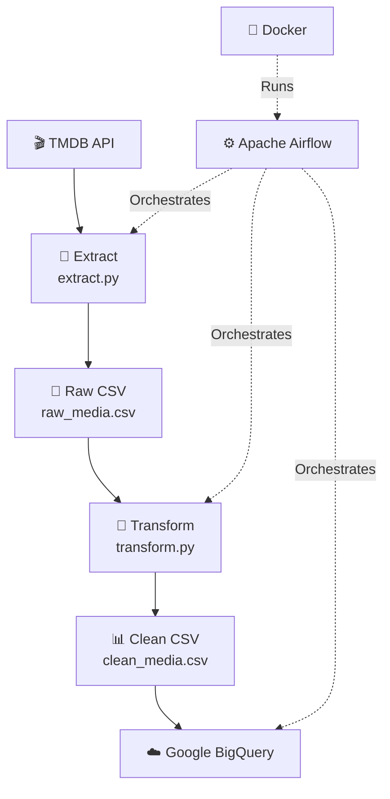
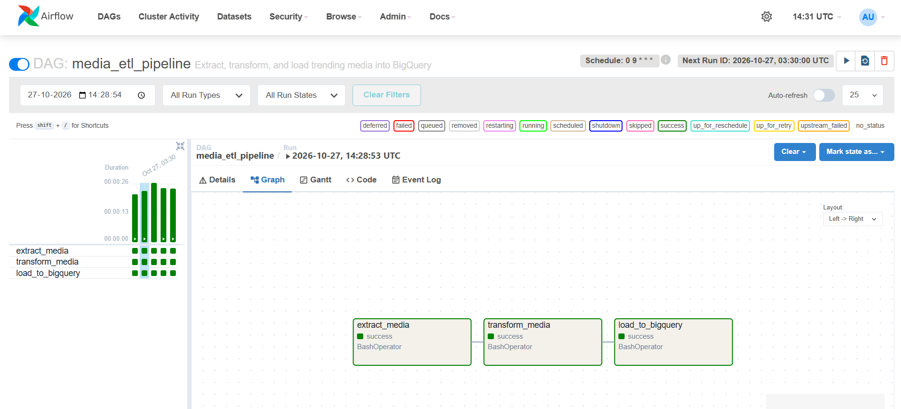
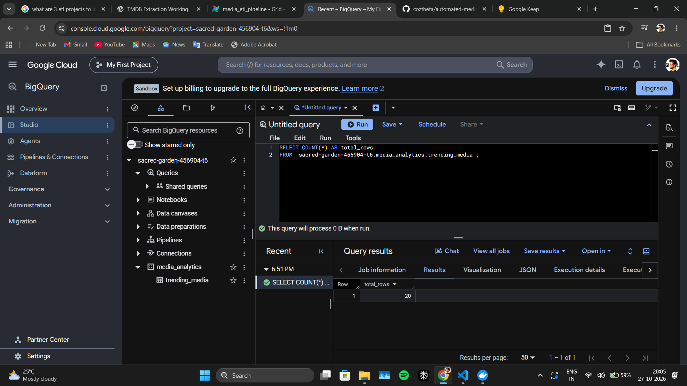
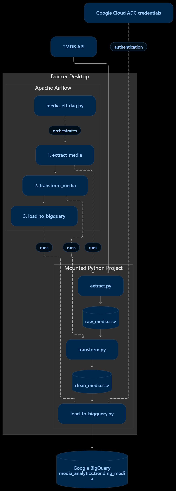

# 🎬 Automated Media ETL Pipeline

<p align="center">
  <strong>A containerized data engineering pipeline that extracts trending media, transforms raw data, and loads analytics-ready datasets into Google BigQuery — orchestrated with Apache Airflow.</strong>
</p>

<p align="center">
  
  
  
  
  
</p>

<p align="center">
  <a href="https://github.com/coztheta/automated-media-etl-pipeline">GitHub Repository</a>
</p>

---

## 📌 Project Overview

The **Automated Media ETL Pipeline** is a beginner-friendly data engineering project that demonstrates how to build and orchestrate an end-to-end Extract, Transform, Load (ETL) workflow.

The pipeline retrieves trending movie and television media data from the TMDB API, processes it with Python and Pandas, and loads the transformed dataset into Google BigQuery for analytics.

Apache Airflow orchestrates the workflow, while Docker provides a consistent local environment for running the pipeline.

### ✨ Key Features

- **Automated extraction:** Fetches trending media data from the TMDB API.
- **Data transformation:** Cleans and prepares data using Python and Pandas.
- **Cloud data warehouse:** Loads processed records into Google BigQuery.
- **Workflow orchestration:** Uses Apache Airflow to manage task dependencies.
- **Containerized environment:** Runs Airflow in Docker.
- **Scheduled execution:** Configured for a daily run at 9:00 AM India time.
- **Credential protection:** Keeps API keys and local credentials outside version control.

---

## 🏗️ Architecture



### Workflow

1. **Extract:** Fetch trending media information from TMDB.
2. **Transform:** Clean the extracted data and prepare the required columns.
3. **Load:** Upload the cleaned dataset into the BigQuery table.
4. **Orchestrate:** Airflow executes the tasks in the correct dependency order.
5. **Schedule:** Airflow is configured to schedule the pipeline daily.

---

## 🛠️ Technology Stack

| Technology | Purpose |
|---|---|
| Python | ETL scripting and data processing |
| TMDB API | Trending media data source |
| Pandas | Data cleaning and transformation |
| CSV | Intermediate data storage |
| Google BigQuery | Cloud data warehouse |
| Google Cloud Python libraries | BigQuery connectivity |
| Apache Airflow | Workflow orchestration and scheduling |
| Docker | Containerized execution environment |
| Git and GitHub | Version control and project hosting |

---

## 📂 Project Structure

```text
automated-media-etl-pipeline/
│
├── airflow/
│   ├── dags/
│   │   └── media_etl_dag.py
│   ├── Dockerfile
│   └── docker-compose.yaml
│
├── extract.py
├── transform.py
├── load_to_bigquery.py
├── test_bigquery.py
├── requirements.txt
├── .gitignore
├── .env.example
└── README.md
```

> **Note:** `.env.example` is a template containing placeholder values. The actual `.env` file, credentials, and generated CSV files should remain local and must not be committed.

---

## ⚙️ Getting Started

### Prerequisites

Install or configure the following before running the project:

- Python 3
- Git
- Docker Desktop with the Docker Engine running
- A TMDB API key
- A Google Cloud project with BigQuery enabled
- Google Cloud Application Default Credentials with permission to access the target BigQuery dataset

### 1. Clone the repository

```bash
git clone https://github.com/coztheta/automated-media-etl-pipeline.git
cd automated-media-etl-pipeline
```

### 2. Create a Python environment

```bash
python -m venv .venv
```

Activate it on Windows PowerShell:

```powershell
.\.venv\Scripts\Activate.ps1
```

Install the dependencies:

```bash
pip install -r requirements.txt
```

### 3. Configure environment variables

Create a local `.env` file in the project root.

Example:

```dotenv
TMDB_API_KEY=your_tmdb_api_key_here
```

Replace the placeholder with your own TMDB API key.

**Never commit your real `.env` file or paste API keys into public repositories.**

### 4. Configure Google Cloud authentication

Install the Google Cloud CLI, sign in, and configure Application Default Credentials:

```bash
gcloud auth application-default login
gcloud config set project YOUR_GCP_PROJECT_ID
```

Replace `YOUR_GCP_PROJECT_ID` with your Google Cloud project ID.

Ensure that the target BigQuery dataset exists and that your Google account has the required permissions to create or update tables.

The project uses Application Default Credentials rather than requiring a service-account JSON key in the repository.

### 5. Run the ETL scripts locally

Run the scripts in order:

```bash
python extract.py
python transform.py
python load_to_bigquery.py
```

The extraction and transformation stages create intermediate CSV files. The loading stage writes the processed data to your configured BigQuery destination.

---

## 🐳 Run with Docker and Apache Airflow

The project includes a custom Airflow image and Docker Compose configuration.

### 1. Validate the Docker Compose configuration

```bash
docker compose -f airflow/docker-compose.yaml config
```

### 2. Build the Airflow image

```bash
docker compose -f airflow/docker-compose.yaml build
```

### 3. Start Airflow

```bash
docker compose -f airflow/docker-compose.yaml up -d
```

### 4. Open the Airflow interface

Navigate to:

**http://localhost:8080**

Sign in using the credentials generated by your local Airflow setup.

### 5. Run the DAG

Open `media_etl_pipeline` in the Airflow interface. Enable the DAG if it is paused, then trigger it manually to test the workflow.

The expected task order is:

1. `extract_media`
2. `transform_media`
3. `load_to_bigquery`

A successful run should show all three tasks as successful in the Graph view.

### 6. Stop Airflow

```bash
docker compose -f airflow/docker-compose.yaml down
```

Stopping the containers also stops scheduled executions. Airflow and Docker must remain running for scheduled tasks to execute.

---

## ⏰ Automated Scheduling

The DAG is configured with the following schedule:

```python
schedule="0 9 * * *"
```

Its start date uses the `Asia/Kolkata` timezone.

| Setting | Value |
|---|---|
| DAG ID | `media_etl_pipeline` |
| Frequency | Daily |
| Intended execution time | 9:00 AM IST |
| Timezone | `Asia/Kolkata` |
| Catchup | Disabled |
| Executor | SequentialExecutor |

Airflow scheduling depends on the scheduler being active and the DAG being unpaused. Verify the displayed next-run time in Airflow after loading the updated DAG.

---

## ☁️ BigQuery Destination

The pipeline was tested successfully against the following BigQuery destination:

| Property | Value |
|---|---|
| Dataset | `media_analytics` |
| Table | `trending_media` |
| Verified query result | 20 rows |

To check the current row count, execute this query in the BigQuery SQL editor:

```sql
SELECT COUNT(*) AS total_rows
FROM `YOUR_GCP_PROJECT_ID.media_analytics.trending_media`;
```

Replace `YOUR_GCP_PROJECT_ID` with your project ID.

The table's write disposition determines whether a new run appends records, replaces the table contents, or uses another write strategy. Review the load script before relying on historical records being retained.

---

## 📸 Screenshots

Screenshots make the project easier to understand for recruiters and other developers.

Add your own screenshots to a `screenshots/` folder and update the image paths below.

### Airflow DAG



*Expected view: the extraction, transformation, and loading tasks all show success.*

### BigQuery results



*Expected view: the query result showing the verified row count.*

### Architecture



*Add an exported architecture diagram here if you create one.*

How to read it
- TMDB API → extract.py: retrieves trending media data.
- Raw CSV → transform.py: cleans and prepares the data.
- Clean CSV → load_to_bigquery.py: sends the processed data to BigQuery.
- Apache Airflow: controls task order and scheduling; it does not replace the Python ETL scripts.
- Docker: runs Airflow and provides access to your mounted project files.
- Google Cloud ADC: authenticates the BigQuery client.

> These are image placeholders. Add actual screenshots before publishing them; the files do not exist automatically.

---

## 🔐 Security Practices

- Store API keys in a local `.env` file.
- Keep `.env` and Google Cloud credentials out of Git.
- Use `.gitignore` to exclude secrets and generated files.
- Use Application Default Credentials for local Google Cloud authentication.
- Never hardcode passwords, tokens, or private keys into Python scripts.
- Check Git history before publishing changes if a secret may have been committed previously.
- Rotate any credential that has been exposed.

---

## 🚀 Future Improvements

- Add automated data-quality checks and schema validation.
- Add structured logging and failure notifications.
- Implement retry policies for transient API and network failures.
- Add incremental loading and deduplication.
- Add data freshness and record-count monitoring.
- Build a dashboard using Looker Studio or another BI tool.
- Add automated tests and continuous integration with GitHub Actions.
- Store operational metrics and historical pipeline run information.

---

## 🎯 Learning Outcomes

This project demonstrates practical experience with:

- Designing an end-to-end ETL workflow.
- Working with REST APIs and JSON data.
- Cleaning and transforming datasets with Pandas.
- Loading analytical data into a cloud data warehouse.
- Orchestrating dependent tasks with Apache Airflow.
- Containerizing applications with Docker.
- Managing source code and protecting credentials with Git and GitHub.

---

## 👨‍💻 Author

**Poornachandra**

GitHub: [@coztheta](https://github.com/coztheta)

Project: [Automated Media ETL Pipeline](https://github.com/coztheta/automated-media-etl-pipeline)

---

<p align="center">
  <strong>Built to learn, automate, and explore data engineering 🚀</strong>
</p>

